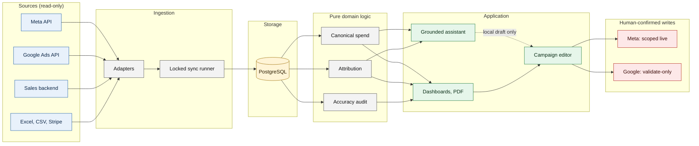

<div align="center">

# Meta & Google Ads Sales Analytics Platform

**A grounded AI assistant, reconciled cross-platform analytics and human-confirmed campaign controls for Meta and Google Ads, with sales attribution that refuses to overclaim.**

Every number traces to a source. Missing data is never zero. The AI can analyse and draft, never write.


[Architecture](#architecture) · [Features](#features) · [AI Assistant](#ai-assistant) · [Data Integrity](#operations-and-data-integrity) · [Engineering](#engineering-highlights) · [Demo](#roadmap)

<!-- PHASE 2: ▶ Try the Interactive Demo link + hero screenshot go here -->

</div>

## Status

| | |
|---|---|
| **Status** | In production for one company (a Slovenian legal-services business) |
| **Meta write** | Live under scoped rules: separate token, allow-listed accounts, editor/admin role, preview, confirmation, read-back, audit log |
| **Google write** | Validate-only. Live Google mutations are not enabled or verified |
| **AI** | Hosted model used through read-only tools, not fine-tuned. No write path |
| **Tests (private)** | 195 test files / 2,096 tests at V4.6. Private repository, not runnable here |
| **Tests (this repo)** | 189 tests for the reference library + 22 for the privacy scanner, run in CI |

## What this repository is

> This repository is a **case study** of a private production system, plus an **independent reference library** (`packages/analytics-core`) that re-implements its core rules with **synthetic examples only**. It contains **no production source code, prompts, data or screenshots**. See [WHATS_PUBLIC.md](WHATS_PUBLIC.md) for exactly what is and is not here, and [NOTICE.md](NOTICE.md) for terms.

## What makes this different

- **It says "no data" instead of 0.** Coverage comes from successful syncs; an API error is never zero spend.
- **One number per thing.** Spend, ROAS and totals come from one canonical path, so card, chart, monthly view and PDF agree.
- **Attribution that does not overclaim.** A "Google" label on a customer is not a Google paid-ad sale; unknown is not "organic"; conflicting evidence is excluded.
- **An AI that must show its sources.** Every number in an answer has to trace to a tool result, or the answer falls back to a labelled rules-based mode.
- **Writes that expect to be wrong.** Preview from the platform, hash-bound confirmation, stale detection, one write, read-back, audit, new objects paused.
- **An audit that can say PARTIAL.** A read-only accuracy audit reports PASS, PARTIAL, FAIL or UNKNOWN, with categorised reasons.

## Features

### AI Assistant

The hero feature. Ask in plain language; the assistant calls **17 read-only server-side tools** (performance, comparisons, sales by source, attribution, data freshness, budget scenarios), stores every tool result as a numbered fact, and must cite those facts. A grounding check then compares every number in the answer with the facts; an untraceable figure triggers one repair round, and if that fails the answer falls back to a clearly labelled rules-based mode. Identifiers the model invents do not resolve and are dropped.

```
question → model → read-only tool calls → numbered facts (F1, F2, …)
         → draft answer → grounding check ─ ok ──→ answer with cited facts
                                         └ fail → repair round → labelled fallback
``` Details: [docs/ai-assistant-architecture.md](docs/ai-assistant-architecture.md).

Example questions of the kinds its tools can answer (verified against the private tool list):

- "How did spend and cost per lead change over the last 30 days compared with the previous 30?"
- "Which ads have the worst cost per result this month, and how confident is that?"
- "What share of confirmed paid orders last month came from each order source?"
- "Compare Meta and Google spend and results. What can I not add together?"
- "Is the data fresh, and which days are missing?"
- "What would moving this budget up by 20 % do to daily spend?" (returned as a labelled scenario)

It also refuses by design: it cannot pause an ad, cannot say which ad caused a sale without a verifiable link, and does not report profit.

### Cross-platform analytics, confirmed sales and attribution

Meta and Google side by side, with results kept by type (forms, visits, clicks, purchases) and never summed. Confirmed sales come from the Crossty sales backend (read-only, GET-only allow-list); each paid order is classified into exactly one source class (Meta, Google, Chatbot/AI, Partner portal, Other verified, Unknown, Conflicting) with evidence levels, and ROAS uses only verifiable evidence. The funnel is kept as separate stages, never merged into one "result":

| Stage | Source | What it is not |
|---|---|---|
| Click | Meta / Google | Not a lead |
| Lead | Meta lead forms, Excel | Not a sale |
| Platform conversion | Meta / Google attribution | Not a confirmed order; platform-modelled |
| Order | Crossty | Not necessarily paid |
| Paid order | Crossty payment status | Not yet linked to an ad |
| Verified attributable revenue | Internal link on verifiable IDs | Only this enters attributable ROAS |

A customer whose source is labelled "Google" is **not** proof of a Google paid-ad sale (it can be organic search, maps or brand search): such orders appear in the Google source class as the weakest evidence level, are never distributed to individual Google campaigns, and Google ROAS is flagged accordingly. The headline subtotal is **Meta + Google + Chatbot/AI**; Partner portal, Other verified, Unknown and Conflicting are shown separately and still reconcile to the total. Details: [docs/attribution-and-sales.md](docs/attribution-and-sales.md).

### Campaign management and ad comparison

| Capability | Status |
|---|---|
| Meta pause, budgets, rename, targeting, creative, create from draft | Live under scoped rules |
| Meta new objects | Created paused; activation is a separate confirmation |
| Google changes | Validate-only |
| AI | Local drafts and proposals only |
| Demo simulation | Planned (Phase 2) |

Legend: *Live under scoped rules* = used in production; *Validate-only* = requests are validated by the platform, nothing is changed; *Simulated* = only in `analytics-core` (`SimulatedWriteAdapter`); *Planned* = roadmap.

**Ad comparison** puts up to four ads, ad sets or campaigns side by side on the same period, with metric direction (lower cost is better, higher rate is better) and ratios computed from sums. It names a winner only when result type, objective, attribution and sample size allow it. Details: [docs/campaign-management.md](docs/campaign-management.md), [docs/ad-comparison.md](docs/ad-comparison.md).

### Financial analytics

Revenue, spend and an "advertising surplus" from selected sources (Meta, Google, Chatbot/AI). **Surplus is not profit**: revenue includes VAT while spend is ex-VAT, and production cost is ignored. The MER ratio was removed in V4.6 because it mixed bases. Attributable ROAS is shown per platform and combined, only when inputs are complete.

### Reporting

Presets for 7, 14, 30 and 90 days, this month, previous month, year to date and a custom range. Daily and Monthly aggregation where it makes sense, expanded chart views, explanatory tooltips, and PDF/print output with solid, greyscale-distinguishable lines.

### Operations and data integrity

Scheduled, locked, idempotent syncs; API plus historical CSV ingestion that fills only gap days and verifies the rest; coverage-based missing-vs-zero; decimal money; time zones handled explicitly; a read-only accuracy audit with categorised PARTIAL results. Details: [docs/data-accuracy.md](docs/data-accuracy.md).

## Architecture



More: [docs/architecture.md](docs/architecture.md), [full system diagram](diagrams/system-architecture.md), [data flow](diagrams/data-flow-reconciliation.md), [assistant flow](diagrams/ai-assistant-flow.md), [action controls](diagrams/campaign-action-controls.md). Static SVG exports are in `assets/diagrams/`.

## Engineering highlights

Twelve problems, each with decision, implementation, verified result and trade-off, in [docs/engineering-challenges.md](docs/engineering-challenges.md). A selection:

- One canonical spend path, so card, chart, monthly view and PDF match.
- CSV history that fills gaps and is verified against the API to the cent where both exist.
- Source classes that reconcile to the total, with an explicit Conflicting class.
- A grounding checker that rejects any number it cannot trace.
- A static test that keeps AI code from importing write modules.

## Public code

`packages/analytics-core` is an **independent reference implementation** written for this showcase, TypeScript with zero runtime dependencies, tested with synthetic data. It is not extracted from the production code.

| Module | Purpose |
|---|---|
| `money.ts` | Exact decimal and minor-unit money |
| `metrics.ts` | Ratios from sums, safe division |
| `dates.ts` | Account time zone days, periods |
| `aggregate.ts` | Daily to monthly aggregation |
| `spend.ts` | Canonical spend, missing vs zero |
| `sources.ts` | Order source classification |
| `attribution.ts` | Evidence levels and ROAS rules |
| `comparison.ts` | Metric direction and comparisons |
| `audit.ts` | PASS, PARTIAL, FAIL, UNKNOWN |
| `write-safety.ts` | Preview, hash, stale and cap checks |
| `assistant/tools.ts`, `assistant/answer.ts` | Tool results as facts and number grounding |
| `synthetic/generate.ts` | Obviously synthetic data |
| `index.ts` | Public exports |

Quick start (Node 22+, no network access or credentials needed after install):

```bash
git clone https://github.com/gabercmatej/Meta-Google-ads-sales-analytics-platform.git
cd Meta-Google-ads-sales-analytics-platform
npm ci
npm test          # reference library tests
npm run example   # builds the library and runs examples/quickstart.mjs on synthetic data
npm run verify    # typecheck, tests, build, example, privacy scan, scanner tests
```

Every example prints `DEMO DATA — NOT REAL BUSINESS RESULTS`. See [examples/README.md](examples/README.md).

## Documentation

| Document | Topic |
|---|---|
| [architecture.md](docs/architecture.md) | System layers, adapters, sync, security boundaries |
| [ai-assistant-architecture.md](docs/ai-assistant-architecture.md) | Tools, fact ledger, grounding, fallback, recommendations |
| [attribution-and-sales.md](docs/attribution-and-sales.md) | Source classes, evidence levels, ROAS, surplus |
| [data-accuracy.md](docs/data-accuracy.md) | Missing vs zero, canonical spend, audit statuses |
| [ad-comparison.md](docs/ad-comparison.md) | Comparison rules and winner conditions |
| [campaign-management.md](docs/campaign-management.md) | Write flow, safety checks, Google validate-only |
| [engineering-challenges.md](docs/engineering-challenges.md) | Twelve problems and decisions |
| [adapting-to-another-business.md](docs/adapting-to-another-business.md) | What transfers and what does not |
| [product-tour.md](docs/product-tour.md) | Screen-by-screen tour (text) |
| [localization-glossary.md](docs/localization-glossary.md) | Slovenian UI terms in English |
| [demo-plan.md](docs/demo-plan.md), [screenshot-plan.md](docs/screenshot-plan.md) | Phase 2 plans |
| [WHATS_PUBLIC.md](WHATS_PUBLIC.md), [SECURITY.md](SECURITY.md), [NOTICE.md](NOTICE.md) | Scope, reporting, terms |

## Adapting to another business

Parts are modular (rules, audit model, write-safety state machine, adapter boundary); others need real engineering (CRM adapter, status vocabulary, source taxonomy, localisation, finance model). No plug-and-play promise. See [docs/adapting-to-another-business.md](docs/adapting-to-another-business.md).

## Roadmap

Phase 2 is an interactive demo on synthetic data with simulated writes. No dates are promised.

## Repository map

```
README.md
WHATS_PUBLIC.md, NOTICE.md
SECURITY.md
docs/            architecture, AI assistant, attribution, data accuracy, ad comparison, campaign
                 management, engineering challenges, adapting, product tour, glossary, demo and
                 screenshot plans
diagrams/        Mermaid sources
assets/diagrams/ exported diagram SVGs
packages/        analytics-core reference library (src + tests)
examples/        runnable synthetic examples and generated samples
scripts/         dependency-free privacy scanner and its tests
.github/         CI: privacy scan, gitleaks, typecheck, tests, build, sample drift check
```

## Notice and licence

**No licence granted.** All rights reserved unless stated otherwise. Read [NOTICE.md](NOTICE.md) before reusing anything.

## Author

Built by [@gabercmatej](https://github.com/gabercmatej).
