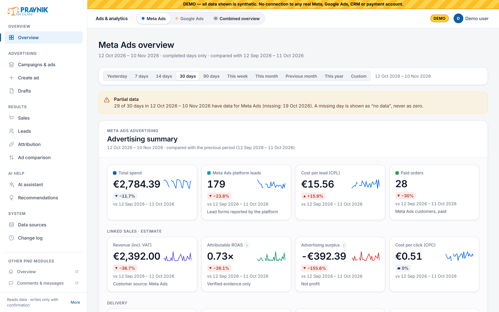
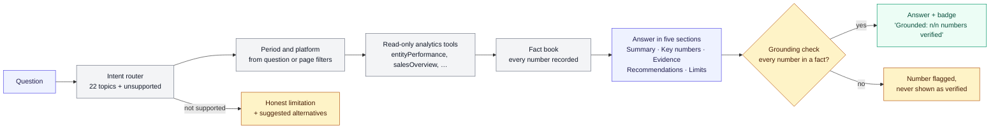
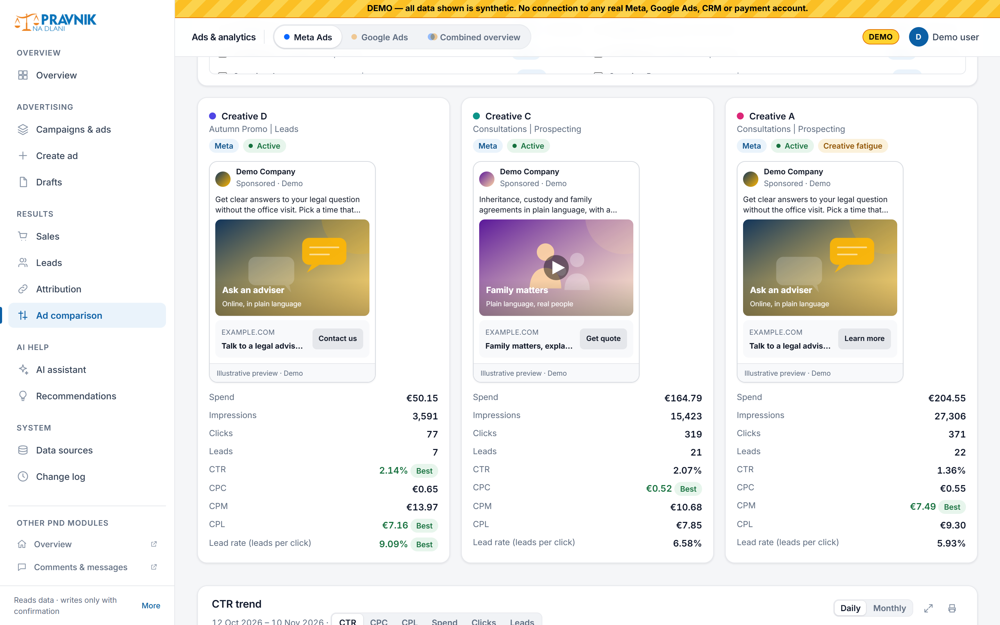
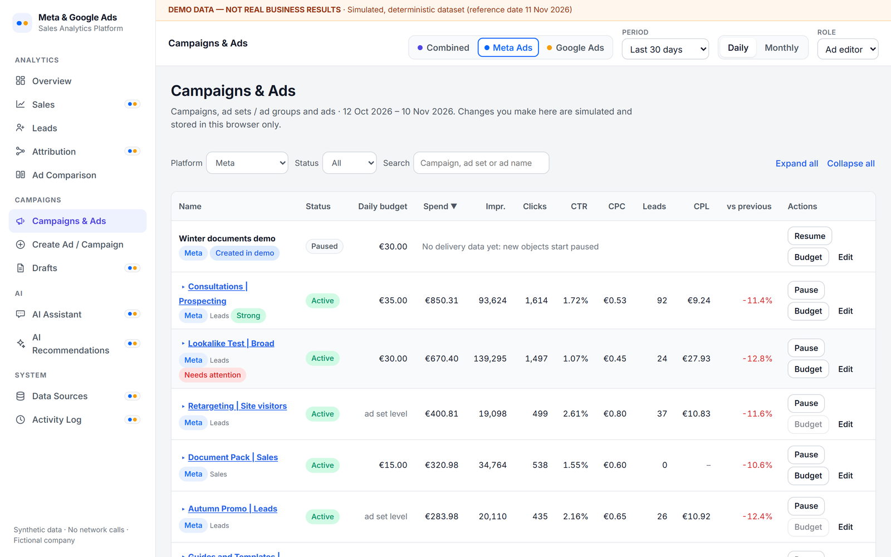
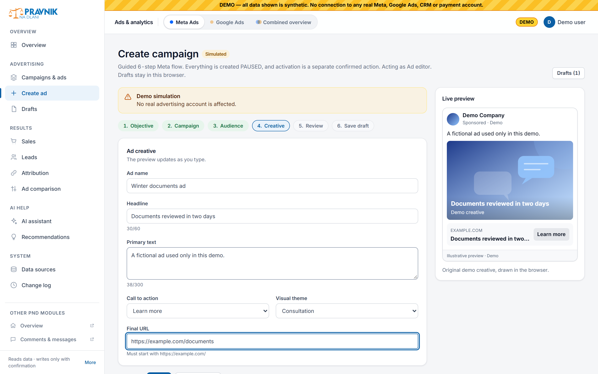
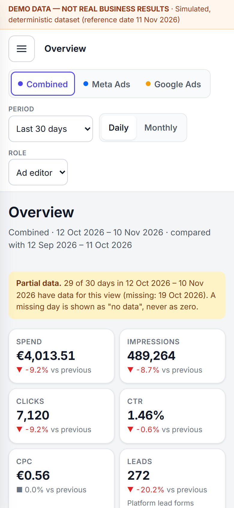
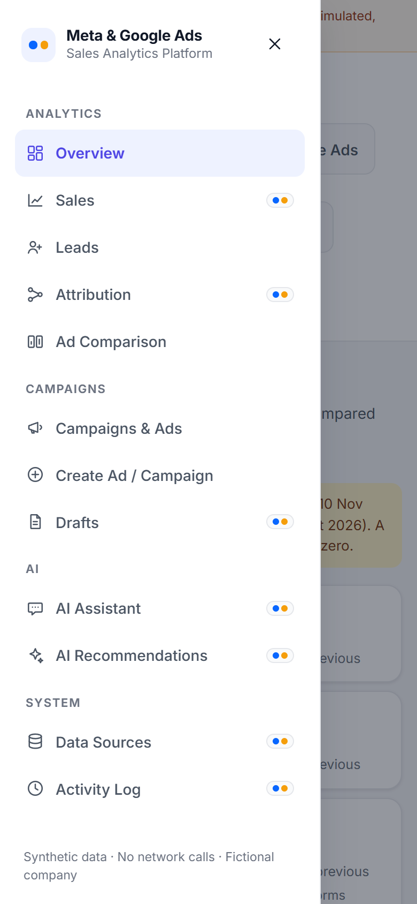
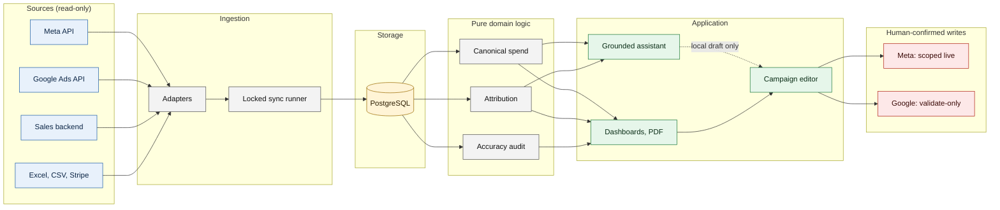

<div align="center">

# Meta & Google Ads Sales Analytics Platform

*AI-powered advertising intelligence, campaign management and verified-sales analytics.*

Every number traces to a source. Missing data is never zero. The AI can analyse and draft, never write.

**[▶ Try the Interactive Demo](https://meta-google-ads-sales-analytics-pla-two.vercel.app)**

<sub>Runs entirely in your browser on synthetic data. No sign-in, no tracking, no network calls.</sub>

[Interactive demo](#interactive-demo) · [AI Assistant](#ai-assistant) · [Ad Comparison](#ad-comparison) · [Analytics and BI](#analytics-and-bi) · [Engineering](#engineering) · [Architecture](#architecture)

</div>



<sub>Screenshot of the interactive demo. **DEMO DATA — NOT REAL BUSINESS RESULTS.** Fictional company, synthetic deterministic dataset.</sub>

## What this repository is

> A **case study** of a private production system used by one company, plus an **independent reference library** (`packages/analytics-core`) and an **interactive demo** (`apps/demo`) that re-implement its core rules on **synthetic data only**. It contains **no production source code, prompts, data or screenshots**. See [WHATS_PUBLIC.md](WHATS_PUBLIC.md) for exactly what is and is not here, and [NOTICE.md](NOTICE.md) for terms.

| | Production system (private) | This repository (public) |
|---|---|---|
| **Data** | Meta, Google Ads, sales backend, Excel, Stripe | Synthetic, deterministic, 12+ months to 11 Nov 2026 |
| **AI** | Hosted model through read-only tools (not fine-tuned) | Deterministic intent router + the same kind of read-only tools, in the browser |
| **Meta writes** | Live under scoped rules | Simulated in browser state only |
| **Google writes** | Validate-only | Validate-only (simulated) |
| **Tests** | 2,096 tests (private, not runnable here) | 217 library + 89 demo + 22 scanner tests, 161 browser checks |

## Interactive demo

A static single-page app with **no backend and no network calls** (`connect-src 'none'` in the Content Security Policy). Everything runs in your browser on a synthetic dataset; campaign changes live in local state and can be reset.

| Area | Pages |
|---|---|
| Analytics | Overview (Combined, Meta, Google) · Sales · Leads · Attribution · Ad Comparison |
| Campaigns | Campaigns & Ads · Create Ad / Campaign · Drafts |
| AI | AI Assistant · AI Recommendations |
| System | Data Sources · Activity Log |

A platform selector (Combined, Meta Ads, Google Ads), date presets (7, 14, 30, 90 days, this month, previous month, year to date, custom range) and a Daily/Monthly toggle apply across pages. Pages that cover both platforms carry a **Meta + Google** marker. Run it locally:

```bash
npm ci
npm run dev:demo      # http://localhost:5173
```

## AI Assistant


The demo assistant is labelled **"Demo AI Assistant — simulated, data-grounded analysis"**. It does not run a language model and it was not trained or fine-tuned on anything. It shows the *orchestration pattern* the production assistant uses: understand the question, call read-only analytics tools, record every result as a fact, write the answer only from those facts, and check that every number in the answer traces back to one.



- **Answers are evidence-first.** Each answer lists the period, platform, tool calls and entity IDs it used; "Show tool calls" opens the trace.
- **22 supported topics**, including spend and leads, Meta vs Google, best and weakest campaign, why CPL changed, creative fatigue, top ads by CTR, budget reallocation (capped at 30 % per change), sales by source, attributable ROAS, advertising surplus, refunds, unknown-source orders, Google-labelled orders without evidence, data quality and month over month.
- **It says what it cannot do.** Forecasts, competitor data, personal customer details and anything outside the dataset get a clear limitation plus questions it *can* answer.
- **No write path.** The assistant can link to a campaign or open the confirmation workflow; it never changes anything itself.

**AI Recommendations** turn the same rules into cards. Each card shows the entity, an evidence table (current vs previous period), the comparison period, an explanation, a concrete next step, a priority, and links to the campaign, the ad comparison and the assistant.


How the production assistant works (tools, fact ledger, repair round, fallback): [docs/ai-assistant-architecture.md](docs/ai-assistant-architecture.md).

## Ad Comparison



Pick two to four ads across Meta and Google and compare them over **the same period**: ad previews, spend, impressions, clicks, leads, CTR, CPC, CPM, CPL and lead rate, plus a trend chart per metric with Daily/Monthly views. Ratios are computed from sums, never averaged. A **Best** marker appears only with enough volume (1,000 impressions for CTR and CPM, 30 clicks for CPC, 5 leads for CPL), because small numbers are noisy. Selections live in the URL, so a comparison can be linked. Details: [docs/ad-comparison.md](docs/ad-comparison.md).

## Simulated campaign management

> **Demo simulation — no real advertising account is affected.**

| Action | Meta (demo) | Google (demo) |
|---|---|---|
| Pause / resume, budget, edit | Preview → validate → confirm → execute (simulated) → read back → audit log | Validate-only: checked, never applied |
| Create campaign / ad | Created **PAUSED**; activation is a separate confirmation | Validate-only |
| Drafts | Save, edit, validate | Save, edit, validate |
| Roles | Viewer is read-only; Ad editor and Admin can act | Same |

Budgets above the per-change cap are rejected, URLs must stay on the advertiser's domain, and every step is recorded in the Activity Log. **Reset demo** restores the original state.

<p>
  
  
</p>

## Analytics and BI

- **Spend, leads, paid orders and revenue** with change vs the previous equal-length period.
- **Sales by source** with a distinct colour per source and a **Meta + Google + Chatbot/AI** subtotal; Partner portal, Other verified, Unknown and Conflicting are shown separately and still reconcile to the total.
- **Attribution kept separate from customer source.** A customer labelled "Google" is not proof of a Google paid-ad sale; only verifiable evidence enters **attributable ROAS**, per platform and combined.
- **Advertising surplus** (selected-source revenue − Meta and Google spend), clearly marked *not profit*.
- **Incomplete periods** are flagged: a missing day is "no data", never zero, and chart lines show gaps instead of dropping to zero.
- **Charts** have legends, tooltips, an expanded view and print/PDF export with solid, greyscale-distinguishable lines.

<p>
  
  
</p>

The funnel stays as separate stages and is never merged into one "result":

| Stage | Source | What it is not |
|---|---|---|
| Click | Meta / Google | Not a lead |
| Lead | Platform lead forms | Not a sale |
| Platform conversion | Meta / Google attribution | Not a confirmed order; platform-modelled |
| Order | Sales backend | Not necessarily paid |
| Paid order | Payment status | Not yet linked to an ad |
| Verified attributable revenue | Internal link on verifiable IDs | Only this enters attributable ROAS |

Details: [docs/attribution-and-sales.md](docs/attribution-and-sales.md), [docs/data-accuracy.md](docs/data-accuracy.md).

## Engineering

- **One canonical number per metric.** Card, chart, monthly view and PDF read the same path; integrity tests check that daily sums equal monthly totals, Combined = Meta + Google, and source partitions reconcile.
- **Missing is not zero.** Coverage comes from successful syncs; an API error is never zero spend.
- **Deterministic synthetic data** with seasonality, a planted missing day, refunds, cancellations, unknown and conflicting sources, and no duplicate orders, all asserted by tests.
- **Grounded answers.** A fact book records every tool result; a checker rejects any number it cannot trace.
- **Writes that expect to be wrong** (production): preview read from the platform, hash-bound confirmation, stale detection, one write, read-back, audit, new objects paused.
- **Locked-down static demo.** Strict CSP with no outbound connections, no secrets, browser tests that fail on any external request, console error, CSP violation or horizontal overflow on desktop and phone.
- **Privacy scanning** of the tree and the full git history, plus gitleaks, in CI.

Twelve production problems with decision, implementation, verified result and trade-off: [docs/engineering-challenges.md](docs/engineering-challenges.md).

<p>
  
  
</p>

## Architecture



This is the production architecture. The public demo replaces sources, storage and writes with a synthetic dataset and simulated state, and reuses `analytics-core` for the domain logic. More: [docs/architecture.md](docs/architecture.md), [full system diagram](diagrams/system-architecture.md), [data flow](diagrams/data-flow-reconciliation.md), [assistant flow](diagrams/ai-assistant-flow.md), [action controls](diagrams/campaign-action-controls.md). Static SVG exports are in `assets/diagrams/`.

## Run and verify

Node 22+. No credentials or network access are needed after install.

```bash
git clone https://github.com/gabercmatej/Meta-Google-ads-sales-analytics-platform.git
cd Meta-Google-ads-sales-analytics-platform
npm ci
npm run dev:demo      # interactive demo
npm test              # reference library tests
npm run example       # library quick start on synthetic data
npm run verify        # typecheck, tests, builds, bundle budget, browser tests, privacy scan
```

`npm run test:browser` needs a local Chrome or Chromium. Every example and every demo page shows `DEMO DATA — NOT REAL BUSINESS RESULTS`. See [examples/README.md](examples/README.md).

### Public code

| Path | Purpose |
|---|---|
| `apps/demo` | Interactive demo: Vite, React 19, React Router, Recharts; assistant engine in `src/ai`, simulation in `src/sim` |
| `packages/analytics-core` | Independent reference library, zero runtime dependencies: money, metrics, dates, aggregation, canonical spend, sources, attribution, comparison, audit, write safety, assistant facts and grounding, synthetic showcase dataset and queries |
| `examples/` | Runnable synthetic examples |
| `scripts/` | Privacy scanner, browser tests, bundle budget |

`analytics-core` is written for this showcase and is not extracted from the production code.

## Documentation

| Document | Topic |
|---|---|
| [architecture.md](docs/architecture.md) | System layers, adapters, sync, security boundaries |
| [ai-assistant-architecture.md](docs/ai-assistant-architecture.md) | Tools, fact ledger, grounding, fallback, recommendations |
| [attribution-and-sales.md](docs/attribution-and-sales.md) | Source classes, evidence levels, ROAS, surplus |
| [data-accuracy.md](docs/data-accuracy.md) | Missing vs zero, canonical spend, audit statuses |
| [ad-comparison.md](docs/ad-comparison.md) | Comparison rules and winner conditions |
| [campaign-management.md](docs/campaign-management.md) | Write flow, safety checks, Google validate-only |
| [engineering-challenges.md](docs/engineering-challenges.md) | Twelve problems and decisions |
| [adapting-to-another-business.md](docs/adapting-to-another-business.md) | What transfers and what does not |
| [product-tour.md](docs/product-tour.md) | Screen-by-screen tour of the production app (text) |
| [localization-glossary.md](docs/localization-glossary.md) | Slovenian UI terms in English |
| [demo-plan.md](docs/demo-plan.md), [screenshot-plan.md](docs/screenshot-plan.md) | How the demo and screenshots were planned and built |
| [WHATS_PUBLIC.md](WHATS_PUBLIC.md), [SECURITY.md](SECURITY.md), [NOTICE.md](NOTICE.md) | Scope, reporting, terms |

## Repository map

```text
README.md, WHATS_PUBLIC.md, NOTICE.md, SECURITY.md
apps/demo/          interactive demo (static SPA, synthetic data, simulated writes)
packages/           analytics-core reference library (src + tests)
docs/               architecture, AI assistant, attribution, data accuracy, comparison,
                    campaign management, engineering, adapting, tour, glossary, plans
diagrams/           Mermaid sources
assets/diagrams/    exported diagram SVGs
assets/screenshots/ screenshots captured from the running demo
examples/           runnable synthetic examples and generated samples
scripts/            privacy scanner, browser tests, bundle budget
.github/            CI: privacy scan, gitleaks, typecheck, tests, builds, browser tests
vercel.json         static hosting config with strict security headers
```

## Notice and licence

**No licence granted.** All rights reserved unless stated otherwise. Read [NOTICE.md](NOTICE.md) before reusing anything.

## Author

Built by [@gabercmatej](https://github.com/gabercmatej).
