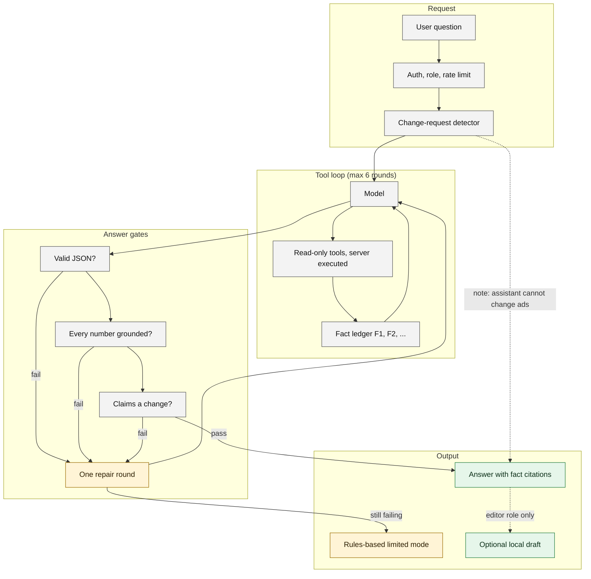

# AI assistant flow

The model never sees a write capability. It calls read-only tools, every tool result becomes a numbered fact, and every number in the final answer must trace back to a fact.

Reading notes

- A local draft is a stored proposal in the application database. Nothing is sent to an ad platform from the assistant; a human opens the editor, sees a preview read from the platform, and confirms.
- Timeouts, provider errors and refusals also end in the limited-mode fallback, which is labelled as such.

