# Campaign action controls

From analysis to execution. Analysis and proposals are cheap and automatic; execution is rare, scoped and human-confirmed. The Google branch stops at validation.

```mermaid
flowchart TB
  subgraph A["1. Analysis"]
    AN["Rules engine or assistant finds an issue"]
  end
  subgraph B["2. Proposal"]
    PR["Structured proposal or local draft"]
    NOEXEC["Executes nothing"]
  end
  subgraph C["3. Validation"]
    PF["Preflight: mode, role, allowed account, stop switch"]
    LIVE["Read current state from the platform"]
    DIFF["Diff, warnings, blockers"]
  end
  subgraph D["4. Human confirmation"]
    HC["Editor or admin confirms exact preview hash"]
    STALE["State changed? abort as stale"]
  end
  subgraph E["5. Permitted execution"]
    MW["Meta: single write, no retry"]
    RB["Read back and compare"]
    LOG["Audit log"]
  end
  subgraph G["Google branch: VALIDATE-ONLY"]
    GV["validate_only request"]
    GN["Nothing applied. Live mutation not enabled"]
  end
  AN --> PR --> NOEXEC
  PR --> PF --> LIVE --> DIFF
  DIFF -- "blocked" --> STOP["Stop"]
  DIFF --> HC --> STALE
  STALE -- "Meta" --> MW --> RB --> LOG
  STALE -- "Google" --> GV --> GN --> LOG

  classDef n fill:#f3f3f3,stroke:#555555,color:#111111
  classDef ok fill:#e6f6ea,stroke:#1e7a3c,color:#0a2d16
  classDef warn fill:#fff4d6,stroke:#9a6b00,color:#2b1d00
  classDef blk fill:#fde8e8,stroke:#b3261e,color:#3b0b08
  class AN,PR,PF,LIVE,DIFF,HC,STALE n
  class NOEXEC,RB,LOG ok
  class MW warn
  class GV,GN,STOP blk
```

Reading notes

- New campaigns, ad sets and ads are created paused. Activation is a second, separately confirmed action.
- Meta writes use a separate scoped token and an allow-list of accounts and campaigns. Google writes are validate-only: live Google mutations are neither enabled nor verified.
- Daily budgets are capped by configuration, and an emergency stop disables all writes without a restart.

