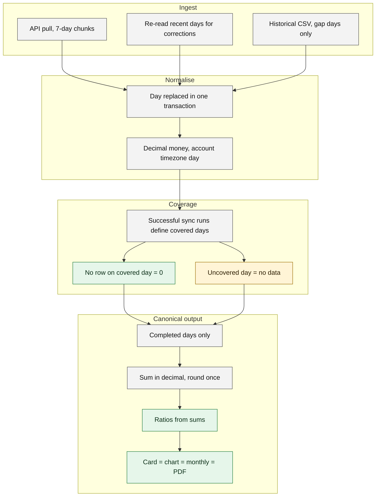
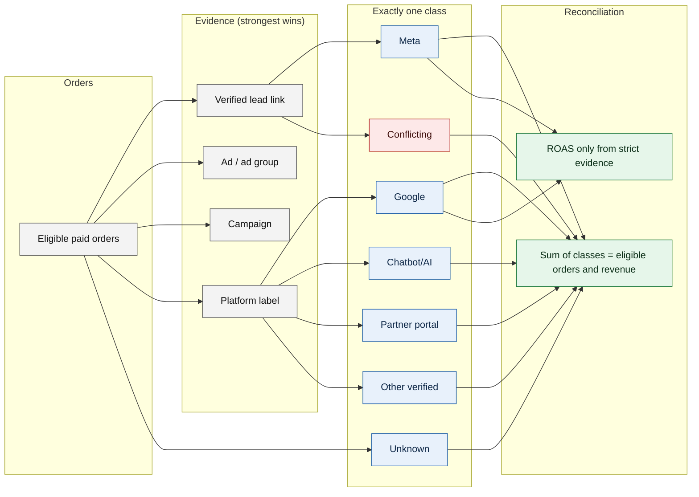

# Data flow and reconciliation

How raw rows become numbers that card, chart, monthly view and PDF all agree on, and how every paid order lands in exactly one source class.

## Spend and ratios

## Order source classification

Reading notes

- Conflicting means contradictory platform evidence; it is excluded from every numerator and from ROAS but stays in the all-sales total.
- A platform label alone (level 1) fills the source split but does not by itself make an order strict paid-ad revenue for a campaign.
- Unknown is never relabelled "organic".

