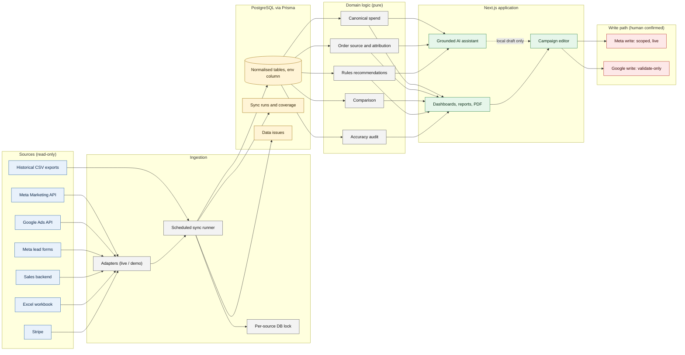

# System architecture

Read-only sources flow into one reconciled database; the AI assistant and the dashboards read from it; the only write path to an ad platform is a human-confirmed, scoped flow.

Reading notes

- Every table carries an `env` column so demo and live data cannot mix.
- The assistant has no edge to the write path. Its only output towards the editor is a local draft that a human must still preview and confirm.
- The Google write box is validate-only: requests are checked by the platform but not applied.

